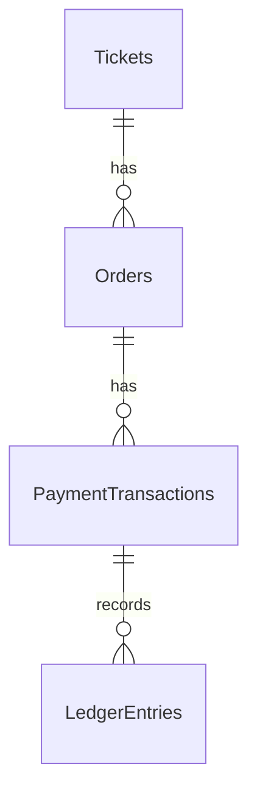

# E-Ticketing System

A ticket booking API built with **ASP.NET Core 8, EF Core, SQL Server, and React**, featuring simulated payments and a double-entry accounting ledger.

## Features

- Gold (AED 100), Premium (AED 200), and VIP (AED 500) tickets.
- Order creation with server-side total calculation and quota protection.
- Credit Card (immediate success) and QR (success after 8 seconds) payments.
- Double-entry ledger for successful payments.
- Docker Compose and GitHub Actions CI.

## Database ERD



## Ledger Consistency

When a payment succeeds, the API updates the payment status, marks the order as paid, and creates two ledger entries in a single database transaction:

- **Debit:** `CASH`
- **Credit:** `TICKET_REVENUE`

Both entries have the same amount, keeping total debits equal to total credits.

If the API crashes before the transaction commits, the database rolls back the uncommitted changes. If it crashes after commit, all changes are already persisted. Conditional payment updates and database constraints help prevent duplicate ledger posting. A background worker retries due QR payment completions.

## Run with Docker

**Prerequisite:** Docker Desktop installed and running.

From the repository root:

```bash
docker compose up --build
```

Ensure EF Core migrations are applied to a fresh database before using the API if automatic migration is not configured.

Stop the containers:

```bash
docker compose down
```

## Tests and CI/CD

Run tests locally:

```bash
dotnet test ETicketing.sln --configuration Release
```

GitHub Actions (`.github/workflows/dotnet.yml`) runs `dotnet build` and `dotnet test` on pushes and pull requests.

## Main API Endpoints

| GET | `/api/Tickets` | List tickets |
| POST | `/api/Orders` | Create an order |
| POST | `/api/Payments/checkout` | Start payment |
| GET | `/api/Payments/{transactionId}` | Check payment status |
